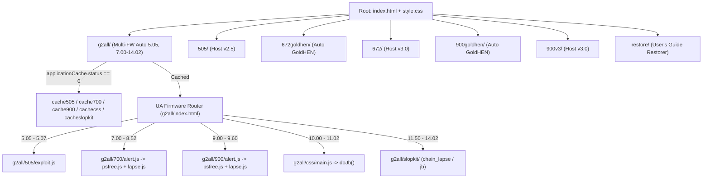

# Architecture

> **Baseline Notice:** This document describes the exact technical architecture of `p4jb` as forked from `GamerHack/GamerHack.github.io`. Update this file whenever directories, exploit chains, or caching mechanisms change.

---

## 1. System Overview

`p4jb` is a 100% static, multi-page, client-side web application engineered to run inside the PlayStation 4 built-in WebKit browser. It serves HTML/CSS/JavaScript exploit chains and binary payloads (`.bin` / `.elf`) and persists them locally on the console using HTML5 Application Cache (`CACHE MANIFEST`) so the console can be jailbroken completely offline.

---

## 2. Architecture Pattern

- **Pattern:** Static Multi-Page Application (MPA) with Client-Side Firmware Routing.
- **Reason:**
  - PS4 firmware versions (`5.05`–`14.02`) span multiple WebKit generations that do not support modern Service Workers or heavy ES2022+ JavaScript bundles.
  - Zero build step allows direct deployment to GitHub Pages or lightweight LAN HTTP servers without compilation.
  - Self-contained directory isolation per firmware lets each host maintain its own `cache.manifest` and prevents unrelated WebKit bugs from leaking across firmware versions.

---

## 3. Technology Stack

- **Markup:** HTML5 (`<!DOCTYPE html>`, `<html manifest="...">` for AppCache).
- **Styling:** Shared CSS3 (`style.css`) + inline layout/status styles.
- **Scripting:**
  - Vanilla ES5/ES6 JavaScript (`505/`, `672/`, `672goldhen/`, `900goldhen/`, `900v3/`, `restore/`).
  - Native ES Modules (`<script type="module">`) in `g2all/700/`, `g2all/900/`, and `g2all/slopkit/`.
  - Web Workers (`g2all/css/worker.js`, `g2all/css/workers.js`, `g2all/slopkit/rpc_worker.js`).
- **Offline Persistence:** HTML5 Application Cache (`window.applicationCache` + `*.manifest` files) and `localStorage` (used in `672goldhen/` for `cached672`, `passcount`, `failcount`).
- **Payload Transport:** `XMLHttpRequest` (`responseType = "arraybuffer"`) and `fetch()` (`g2all/css/main.js`) to load binary `.bin`/`.elf` payloads into allocated RWX memory pages via syscall `477` (`mmap`) / `pthread_create`.
- **Database / Backend / Auth:** None (pure static file hosting).

---

## 4. System Components

### Root Entry (`/` — `index.html`, `style.css`)
- Presents the top-level firmware selector and links to each sub-host.
- Hosts shared visual tokens (`style.css`), background video loader (`bg-video.js`), and crypto donation QR assets (`btc.jpg`, `eth.jpg`).

### Multi-FW Auto-Host (`g2all/`)
- Inspects `navigator.userAgent` with `/PlayStation 4[ /]([\d.]+)/i`.
- Routes uncached clients (`window.applicationCache.status == '0'`) to a firmware-family cache installer (`cache505.html`, `cache700.html`, `cache900.html`, `cachecss.html`, `cacheslopkit.html`).
- Routes cached clients to the matching exploit entrypoint (`505/exploit.js`, `700/alert.js`, `900/alert.js`, `css/main.js`, or `slopkit/*`) and loads `g2all/goldhen_2.4b18.14.bin`.

### Dedicated Legacy Hosts (`505/`, `672goldhen/`, `672/`, `900goldhen/`, `900v3/`)
- Single-firmware hosts supporting either automatic GoldHEN (`672goldhen/`, `900goldhen/`) or full interactive payload dashboards (`505/`, `672/`, `900v3/`).
- Each folder bundles its own `cache.manifest`, exploit scripts, and `.bin` payloads.

### Restore Host (`restore/`)
- Sub-hosts (`505/`, `672/`, `672goldhen/`, `900goldhen/`, `900v3/`) that execute the firmware exploit and immediately inject `payload.bin` to restore the User's Guide cache without DNS.

---

## 5. Architecture Diagram



---

## 6. Data Flow

1. User opens `/` or a sub-host directly in the PS4 browser.
2. Page evaluates `window.applicationCache.status` (or `localStorage.cached672` on `672goldhen/`).
3. If uncached (`status == '0'`), browser loads `<html manifest="...">` page and downloads every listed resource into offline storage.
4. Once cached, page executes the firmware-specific WebKit userland exploit to gain arbitrary read/write (`addrof`/`fakeobj` or `arw`).
5. Exploit resolves ROP/syscall primitives (`libkernel`, `libc`) and runs the kernel exploit (`lapse`, `poops`, `kexploit`, etc.) + firmware patches (`.elf` / `.bin`).
6. Payload loader fetches target `.bin` via `XMLHttpRequest` (`arraybuffer`) or `fetch()`, copies 4-byte-aligned shellcode into RWX memory, and executes it (`fcall` or `pthread_create`).
7. Status text updates `#msgs` in the DOM.

---

## 7. Project Structure

```text
p4jb/
├── AGENTS.md                  # AI coding agent instructions
├── README.md                  # Quick steps & firmware list
├── index.html                 # Root firmware & host selection menu
├── style.css                  # Shared global stylesheet
├── bg-video.js                # Shared background video injector
├── btc.jpg / eth.jpg          # Crypto donation QR images
├── docs/                      # Project documentation suite (10 files)
├── 505/                       # PS4 5.05 Host v2.5 (exploit.js, cache.html, cache.manifest, *.bin)
├── 672goldhen/                # PS4 6.72 Auto GoldHEN host (jb.js, cache.manifest, goldhen)
├── 672/                       # PS4 6.72 Host v3.0 (jb2.js, frontend.js, payload.js, *.bin)
├── 900goldhen/                # PS4 9.00 Auto GoldHEN host (webkit.js, kexploit.js, rop.js, int64.js)
├── 900v3/                     # PS4 9.00 Host v3.0 (full payloads, Linux loaders, webactivator, mods)
├── g2all/                     # Multi-FW Auto-Host (5.05 & 7.00-14.02)
│   ├── index.html             # UA parser & firmware router
│   ├── cache*.html            # Per-family cache installers
│   ├── *.manifest             # Per-family AppCache manifests
│   ├── goldhen_2.4b18.14.bin  # Shared GoldHEN binary
│   ├── 505/                   # 5.05 exploit.js
│   ├── 700/                   # PSFree + Lapse (7.00-8.52) + kpatch/*.elf
│   ├── 900/                   # PSFree + Lapse (9.00-9.60) + kpatch/*.elf
│   ├── css/                   # 10.00-11.02 chain + workers + ps4/patches/*.bin
│   └── slopkit/               # 11.50-14.02 chains + patches/*.bin
└── restore/                   # User's Guide restore hosts (505, 672, 672goldhen, 900goldhen, 900v3)
```

---

## 8. Dependency Rules

- **Offline Self-Containment:** Every file loaded during offline jailbreak execution (HTML, CSS, JS, images, `.bin`, `.elf`) must reside in the repository and be declared in the corresponding `*.manifest`.
- **No External Runtime Dependencies:** Do not import external CDNs, Google Fonts, or remote JS libraries into cached exploit pages.
- **Relative Paths Only:** Sub-hosts reference root assets via `../style.css` and `../bg-video.js` (or `../../style.css` and `../../bg-video.js` inside `restore/<fw>/`) so the site works both at domain root and under a GitHub Pages repository subpath (`/p4jb/`).
- **Upstream Isolation Rule:** Keep personal customizations decoupled from low-level exploit engines whenever possible to avoid merge conflicts with `upstream-main`.

---

## 9. Key Technical Decisions

See [DECISIONS.md](DECISIONS.md) for full ADRs covering:
- **Decision 001:** Pure static HTML/CSS/JS with no build tool.
- **Decision 002:** HTML5 AppCache over Service Workers.
- **Decision 003:** `main` + `upstream-main` + `feat/*` Git branching model.
- **Decision 004:** Conflict-minimizing customization isolation.

---

## 10. Performance Considerations

- `html { overflow: hidden; }` prevents scroll reflow on PS4 WebKit.
- Splitting `g2all/` into 5 separate firmware-family manifests (`505.manifest`, `700.manifest`, `900.manifest`, `css.manifest`, `slopkit.manifest`) avoids forcing a console to download and cache gigabytes/megabytes of exploit scripts for other firmware versions.
- Inline `<script>` heap-spray / primitive setup (`672*/index.html`) executes immediately on load; avoid heavy DOM thrashing during WebKit heap sprays.

---

## 11. Scalability Considerations

- Adding a new PS4 firmware target requires either adding a branch + patch/offset file inside `g2all/` (and updating the corresponding `*.manifest`) or adding a new isolated directory linked from `index.html`.
- Adding new payloads to `505/`, `672/`, or `900v3/` requires placing the `.bin`, adding the button/loader function, and registering the `.bin` in `cache.manifest`.

---

## 12. Failure Scenarios & Known Baseline Quirks

- **Known Baseline Quirk — Backslashes in `g2all/*.manifest`:**
  - `g2all/505.manifest`, `g2all/700.manifest`, `g2all/900.manifest`, `g2all/css.manifest`, and `g2all/slopkit.manifest` currently use Windows backslashes (`\`, e.g., `700\alert.js`) instead of forward slashes (`/`). On strict HTTP/Linux servers (like GitHub Pages) or WebKit URL resolvers, backslashes in manifest URLs can cause 404s during AppCache installation. This is documented as a baseline issue to verify and normalize in a dedicated fix branch.
- **Root `index.html` Line 8 Typo (Fixed):**
  - Upstream baseline had `var histlength=history.length;history.go(-histlength 2);` (missing operator before `2`), throwing `Uncaught SyntaxError: missing ) after argument list`. Fixed to `history.go(-histlength);` matching the `cache.html` sub-hosts.
- **Online-Only Payloads Offline:** Clicking `PS4 Trainer Web` or online Game Mods while offline fails network navigation.
- **Unlisted Asset in Manifest:** Any new file not listed in `*.manifest` will fail with `onScriptError()` or missing payload when offline.
