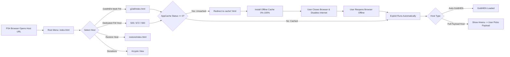

# UX Flows

> **Baseline Notice:** This document maps the actual user journeys in the current `p4jb` baseline. Update these flows whenever navigation, caching behavior, or menu interactions are customized.

---

## Overview Journey

---

## Flow 1 — First-Time Online Cache Installation

**Applies to:** `g2all/`, `505/`, `900goldhen/`, `900v3/` (redirect pattern) and `672/`, `672goldhen/` (inline manifest pattern).

1. User connects PS4 to the internet and navigates to the host URL (e.g., `/` → selects `GoldHEN Multi FW`).
2. `g2all/index.html` checks `navigator.userAgent` for `PlayStation 4[ /]([\d.]+)` and checks `window.applicationCache.status`.
3. Because the host is not yet cached (`status == '0'`), the page calls `window.location.replace(...)` to the firmware-matched cache installer (`cache505.html`, `cache700.html`, `cache900.html`, `cachecss.html`, or `cacheslopkit.html`), or `cache.html` in single-firmware hosts.
4. `applicationCache` fires `progress` events; `#msgs` updates with `"Installing Offline Cache: X%"`.
5. Once all manifest assets are stored, `oncached` (or `onupdateready`) fires.
6. `#msgs` updates to `"Cache Installed Successfully ✔"`, then after `1500ms` changes to `"Now Close And Re-Open Your Browser ..."`.
7. User exits the PS4 browser, disables internet in PS4 Network Settings, and reopens the browser.

- **Success:** All offline assets are stored locally; subsequent visits bypass cache installation and run offline.
- **Failure:** `applicationCache.onerror` triggers `"Error Installing Cache! - Clear and Re-Open Your Browser ..."` (on `672goldhen/index.html`, `onerror` still sets `localStorage.cached672 = "yes"`).
- **Loading State:** `"Starting Cache Installation..."` or `"Wait a Moment..."` prior to first `progress` event.

---

## Flow 2 — Offline Multi-FW Auto-Exploit (`g2all/`)

1. User opens the cached `g2all/index.html` offline in the PS4 browser.
2. Script parses `navigator.userAgent`:
   - Extracts firmware float (`fwNum`) and string (`fwVersion`).
3. `window.applicationCache.status != '0'` branch executes.
4. Based on `fwNum`, the router dynamically injects the corresponding exploit script into `<head>`:
   - `5.05` / `5.07` → `505/exploit.js`
   - `7.00`–`8.52` → `700/alert.js` (`type="module"`)
   - `9.00`–`9.60` → `900/alert.js` (`type="module"`)
   - `10.00`–`11.02` → `css/main.js` (calls `doJb()` after `500ms`)
   - `11.50`–`11.52` → `slopkit/chain_lapse.js` (`type="module"`)
   - `12.00`–`14.02` → `slopkit/jb.js` (`type="module"`)
5. Exploit runs kernel jailbreak and loads `goldhen_2.4b18.14.bin`.

- **Loading State:** `#msgs` displays `"Loading GoldHEN v2.4b18.14... Please Wait"`.
- **Success:** `#msgs` updates to `"GoldHEN v2.4b18.14 Loaded ..."` (or `"GoldHEN is Already Loaded ..."` if `setuid(0)` succeeds in `css/main.js`).
- **Error States:**
  - Non-PS4 browser: `"Only for PS4 with Firmware 5.05 and 7.00 to 14.02"`.
  - Unsupported PS4 FW (e.g., `6.72` or gap versions): `"Unsupported Firmware: <version>"` (version in red).
  - Missing script (`script.onerror`): `"Content not Found! - Clear Browser Data and Re-Install Cache ..."`.
  - Exploit failure (`slopkit` / `css`): `"Failed to Load! Restart Your Console ..."` in yellow.

---

## Flow 3 — Dedicated Full-Menu Firmware Host (`505/`, `672/`, `900v3/`)

1. User selects a dedicated host from root `index.html` (e.g., `5.05 FW v2.5`, `6.72 FW v3.0`, or `9.00 FW v3.0`).
2. After cache verification, the page displays `#progress` (`"Loading... Please Wait"` / `"Loading Jailbreak... Please Wait"`) and executes the WebKit/kernel exploit on `onload` (`setTimeout(..., 50)`).
3. On exploit completion (`success()`), `#progress` is hidden (`display: none`) and `#menu` becomes visible (`display: block`).
4. User hovers over payload buttons; top header `#msgs` previews the payload description (`onmouseover`) and resets on `onmouseout`.
5. User clicks a payload button (e.g., `GoldHEN v2.4b18.14`, `FTP`, `App2USB`, or selects `tempC` and clicks `Fan Threshold`).
   - Optionally opens submenus: `Games-Mods` (`#mods`), `Linux Loaders` (`#lnx`), or navigates to `webactivator.html` (`900v3`).
6. Page fetches the `.bin` payload via `XMLHttpRequest` (`arraybuffer`), writes it to executable memory, and runs it (`p.fcall` / `pthread_create`).

- **Success:** `#msgs` displays `"<Payload> Loaded ✔"` (or Bin Loader instructions on port `9020`).
- **Empty / Submenu State:** `#mods` and `#lnx` replace `#menu` until user clicks `Return`.
- **Failure:** On `672/` and `672goldhen/`, `localStorage.failcount` increments and displays in the header counter (`Fail = N`) if the exploit fails before completion; WebKit memory errors may require refreshing the page or restarting the console.

---

## Flow 4 — Restore Host to User's Guide (`restore/`)

1. User clicks `Restore Host` on root `index.html` (`location.replace('restore/index.html')`).
2. User selects their console firmware (`5.05 FW v2.5`, `6.72 FW GoldHEN`, `6.72 FW v3.0`, `9.00 FW GoldHEN`, or `9.00 FW v3.0`).
3. The selected page runs its firmware exploit and automatically injects the local `payload.bin` (User's Guide cache restoration payload).

- **Success:** `#msgs` updates from `"Loading Payload... Please Wait"` to `"Payload Loaded ..."`.
- **Return Flow:** Clicking `Return` navigates back to `../index.html`.

---

## Flow 5 — Crypto Donations Toggle (`index.html`)

1. On root `index.html`, user clicks `For Donations (Only in Cryptocurrencies)`.
2. `donations()` sets `#crypto` to `display: block` and `#menu` to `display: none`, displaying BTC and ETH QR codes (`btc.jpg`, `eth.jpg`) and wallet addresses.
3. User clicks `Return`; `load_menu()` restores `#menu` and hides `#crypto`.
